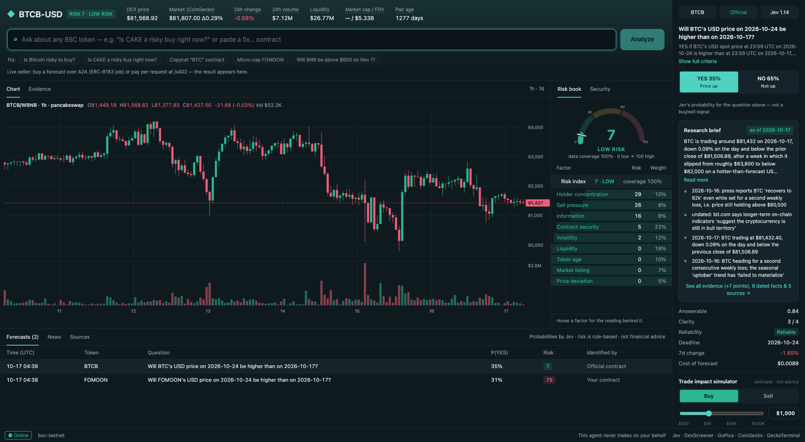

# Jev Risk Oracle (jevGreenfield)

**A paid AI agent on BNB Chain that tells you how risky a BSC token trade is, and how likely it is to go up, before you trade.**

Ask in plain language ("Is CAKE a risky buy right now?" or just a `0x…` token address). The agent:

1. researches the token on the web for current, dated, sourced facts,
2. pulls live on-chain market data (PancakeSwap via DexScreener), an all-venue reference price and listing check (CoinGecko), and a contract security scan (GoPlus),
3. asks **Jev**, TypeSafe's calibrated "System One" decision model, for a probability,
4. computes a deterministic **trade risk index (0–100)**,

and delivers it all as one JSON report, including the last 7 days of hourly prices. Buyers pay per forecast in stablecoins over **ERC-8183** jobs or **x402**. A live **dashboard** shows every forecast.

> The agent never trades and never signs anything on a model's say-so. It sells information; the buyer decides.



## How it works

```
buyer ── A2A negotiate → ERC-8183 job funded on BSC ──┐
      └─ or pay-per-request at /x402 (B402) ──────────┤
                                                      ▼
            researcher (OpenRouter + web search)   identify token, frame a yes/no question,
                         │                          dated news, for/against points
                         ▼
            DexScreener + GoPlus + CoinGecko       price, liquidity, volume, trades, pair age;
            + GeckoTerminal                         honeypot, taxes, mint/owner powers, holders;
                         │                          reference price, market cap, listing status;
                         │                          7-day hourly price history
                         ▼
            Jev (OpenRouter Decisions API)         P(YES), answerable, clarity — calibrated, ~1 s
                         │
                         ▼
            risk.ts (deterministic)                9 components → 0–100 index + critical flags
                         │
                         ▼
            deliverable JSON  ──► submitted on-chain (ERC-8183) / returned (x402)
                         └──────► /dashboard
```

Generic trading questions are normalized into a resolvable one, e.g.
*"Will CAKE's USD price on 2026-10-24 be higher than on 2026-10-17?"*. That way Jev's probability can later be scored against what actually happened.

## The trade risk index

Rule-based and reproducible: same inputs, same score. No LLM touches it.

| Component | Weight | Source | High risk when |
|---|---|---|---|
| Contract security | 22% | GoPlus | honeypot, owner can edit balances, hidden owner, unverified source, tax > 10%, mintable, proxy |
| Liquidity | 18% | DexScreener | top pair < $10K (log scale to $5M) |
| Volatility | 12% | DexScreener | large 1h / 6h / 24h moves |
| Holder concentration | 10% | GoPlus | top-10 holders > 80% (burn and locked addresses excluded) |
| Sell pressure | 8% | DexScreener | sells dominate 24h trades, or almost no trades |
| Token age | 10% | DexScreener | pair younger than 7 days (log scale to 1 year) |
| Information | 8% | Jev | Jev reports the evidence is insufficient |
| Market listing | 7% | CoinGecko | not listed under this contract (CoinGecko is curated, so copycats and fresh launches are not listed) |
| Price deviation | 5% | CoinGecko vs DEX | DEX price ≥ 10% away from the all-venue price, which points to a thin or manipulated pair |

A weighted average alone would let one fatal problem be diluted by healthy readings elsewhere. So the score is floored at **75 (high)** if contract security, liquidity or concentration is near its maximum, or if the token is an **impersonator** (it uses a major ticker such as `BTC` but is not the official contract). A honeypot is floored at **95**. The triggering findings are listed in `risk.critical`.

### Getting the right token

Copycat tokens make ticker lookup the easiest place to go wrong. On BSC a fake "BTC" trades at $117, and a fake "WBNB" is paired with a fake "USTT" to fabricate liquidity. The agent identifies tokens in this order of trust, and records which step matched in `token.match`:

1. **`address`**: a contract address the buyer typed.
2. **`registry`**: 18 major tokens (BTCB, WBNB, ETH, USDT, USDC, CAKE, …), pinned to official contracts that were checked live. Aliases are covered: *Bitcoin/BTC → BTCB*, *BNB → WBNB*.
3. **`research`**: an address the researcher found on the web. Marked unverified.
4. **`symbol`**: an exact ticker match, counting only pairs quoted in real WBNB / USDT / USDC / BUSD / FDUSD / USD1 / U / BTCB / ETH. Marked unverified.

The dashboard shows a warning chip whenever the match is unverified.

Measured on 2026-10-17:

| Request | Risk | P(up in 7d) | Jev reliability |
|---|---|---|---|
| "Is CAKE a risky buy right now?" | **7 · low** | 41% | reliable (answerable 0.76) |
| "Is Bitcoin risky to buy?" (→ BTCB, $81,610) | **9 · low** | 48% | reliable (answerable 0.79) |
| a copycat "BTC" contract at $117 | **75 · high** (impersonation) | 52% | — |
| a 19-day-old token, $5.6K liquidity, top-10 own 96.6% | **75 · high** | 32% | low confidence (answerable 0.13) |

## Why Jev

Jev is not a chat model. It takes a JSON `state` plus typed questions and returns calibrated probabilities: no prose, ~$0.00006 per decision, about 1 s. It cannot browse, so on its own it correctly refuses to price news-driven questions. In our test, without the research brief Jev reported `answerable = 0.08`; with the brief it reported `0.81`. The researcher supplies the evidence, and Jev makes the calibrated call. We use `typesafe/jev-1.14`; set `JEV_MODEL` to switch.

## BNB Chain integration

- **ERC-8183 commerce:** `negotiate` returns an EIP-191-signed quote (fixed USD price → TEST_U / TEST_USDC / TEST_USDT). The buyer funds the job on BSC. `notify_funded` verifies the job on-chain, produces the report, and submits it on-chain.
- **x402 via B402:** anonymous pay-per-request HTTP at `/x402`.
- **ERC-8004 identity:** registered at deploy time with the public endpoint.
- **Built with** [bnbagent-studio](https://github.com/bnb-chain/bnbagent-studio) (`bag`). One runtime holds the key, and every signature comes from fixed code in `app/agent/src/signing.ts`. Models produce the report only; they can never trigger a signature or a transfer.

## Try it locally

Prerequisites: Node ≥ 22, `bag` (`npm i -g @bnbagent/studio-cli`), an OpenRouter key with credits.

```bash
npx -y pnpm@10.24.0 install
bag env set OPENROUTER_API_KEY sk-or-v1-...      # stored in .studio/.env.local (never committed)
bag env set COINGECKO_API_KEY CG-...             # optional free Demo key; without it the public tier rate-limits
DASHBOARD_DEMO=1 bag dev                          # agent on :9000
open http://localhost:9000/dashboard/            # demo box runs forecasts without payment
```

A forecast takes ~8–15 s (research runs without model reasoning; market data loads in parallel) and costs about $0.01 in OpenRouter credits. The same question within 30 minutes reuses its research brief and returns in ~1 s with fresh market data and a fresh Jev call (`RESEARCH_TTL_MINUTES`). Demo mode is capped at 20 runs per process (`DASHBOARD_DEMO_MAX`) and is for local use only.

Ask for a quote over A2A:

```bash
curl -s localhost:9000/ -H 'Content-Type: application/json' -d '{
  "jsonrpc":"2.0","id":1,"method":"message/send",
  "params":{"message":{"kind":"message","role":"user","messageId":"1",
    "parts":[{"kind":"data","data":{"skill":"negotiate",
      "task_description":"Is CAKE a risky buy right now?",
      "terms":{"deliverables":"forecast + risk JSON","quality_standards":"sourced, dated evidence"}}}]}}}'
```

## Run it on another computer

Share the code, never the secrets. The package below leaves out `.studio/` (wallet keystore, wallet password, API keys) and `node_modules/`.

```bash
# on this machine
tar --exclude=node_modules --exclude=.studio --exclude=dist --exclude=.claude --exclude=.DS_Store \
    -czf jevGreenfield.tar.gz jevGreenfield

# on the other machine (Node 22+, then: npm install -g @bnbagent/studio-cli@0.0.15)
tar -xzf jevGreenfield.tar.gz && cd jevGreenfield
./setup.sh                        # installs deps, creates a wallet, asks for your OpenRouter key (hidden)
DASHBOARD_DEMO=1 bag dev          # http://localhost:9000/dashboard/
```

To keep the **same seller wallet**, copy the `.studio/` folder yourself (USB stick or AirDrop, never chat, email or git) into the project root before running `./setup.sh`; it then reuses that wallet and its keys. Otherwise `setup.sh` creates a fresh testnet wallet for that machine.

## Code map

| File | Role |
|---|---|
| `app/agent/src/oracle.ts` | the pipeline: research → market → Jev → risk → deliverable |
| `app/agent/src/jev.ts` | OpenRouter Decisions API client (Jev) |
| `app/agent/src/research.ts` | web-search researcher, token identification, odds-site filter |
| `app/agent/src/market.ts` | token identification (registry, trusted quotes) + DexScreener + GoPlus + CoinGecko, read-only |
| `app/agent/src/risk.ts` | deterministic risk index |
| `app/agent/src/dashboard.ts`, `dashboardPage.ts` | `/dashboard`, laid out like a trading terminal: a prominent ask bar with one-click examples, market strip, a 0–100 risk gauge, 7-day hourly candles + volume (OHLC crosshair, keyboard), a "risk book" (risky factors red above the index, safe ones green below), the Jev forecast ticket with the research brief behind it (summary, as-of date with a stale-evidence flag, top points for and against), a trade impact simulator (constant-product slippage and price impact for a $100–$100K buy or sell), a token card with copyable contracts and BscScan / DexScreener / PancakeSwap links, and forecast / news / source tables |
| `app/agent/src/unifiedMain.ts` | A2A + x402 entrypoint (bnbagent-studio scaffold) |
| `app/agent/src/signing.ts` | the only signing code: quotes and on-chain submit |

## Safety design

- Signing is fixed handler code, never a model tool. Market and security lookups are read-only.
- The wallet keystore and API keys live in `.studio/`, outside the deploy bundle and git.
- Dashboard content comes from buyers, models and the web, so it is rendered with `textContent` only and served with a strict CSP.
- The researcher excludes prediction-market and odds sites, so Jev forms an independent view.

## Limitations

- Forecast history lives in memory and resets on restart.
- The dashboard is public wherever the agent is reachable and shows buyers' questions. Set `DASHBOARD_ENABLED=0` to disable it.
- Paid x402 needs B402 merchant credentials. Replay protection is in memory only.
- Jev tends to be under-confident near 0 and 1, so extreme probabilities should be read with care.
- Not financial advice.

## Credits

- `jev.ts` and `research.ts` are adapted from [markusbug/jevymarket](https://github.com/markusbug/jevymarket), MIT License © 2026 Markus Haas.
- [Jev](https://openrouter.ai/docs/guides/community/jev) by TypeSafe AI, via OpenRouter.
- Market data: [DexScreener](https://dexscreener.com), [CoinGecko](https://www.coingecko.com/en/api) and [GeckoTerminal](https://www.geckoterminal.com) APIs. Contract security: [GoPlus Security](https://gopluslabs.io) API.
